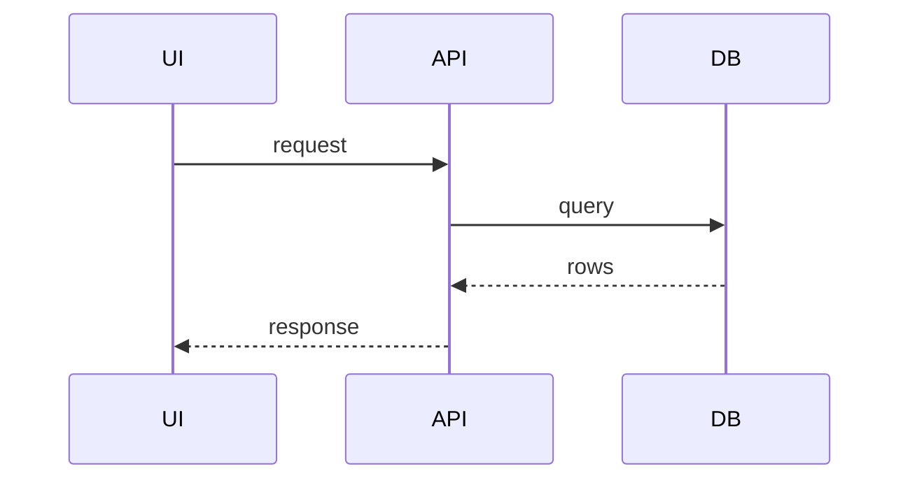

<!-- Cards are generated from docs/assets/cards.json with repo-polish (tools/cards/cards.py). Regenerate after editing it. -->

<picture>
  <source media="(prefers-color-scheme: dark)" srcset="docs/assets/hero-dark.svg"/>
  
</picture>

<p align="center">
  <a href="#-see-it-work"><b>Demo</b></a> &nbsp;·&nbsp;
  <a href="#-how-it-works"><b>Architecture</b></a> &nbsp;·&nbsp;
  <a href="#-run-it"><b>Run it</b></a> &nbsp;·&nbsp;
  <a href="#-whats-next"><b>What's next</b></a>
</p>

<!-- TODO(owner): one line of context — where/why this was built -->

## ▸ See it work

<p align="center">
  
</p>
<p align="center"><sub>Real run against DATASET · waits for the model are sped up</sub></p>

<picture>
  <source media="(prefers-color-scheme: dark)" srcset="docs/assets/capabilities-dark.svg"/>
  
</picture>

## ▸ How it works

<picture>
  <source media="(prefers-color-scheme: dark)" srcset="docs/assets/architecture-dark.svg"/>
  
</picture>

<picture>
  <source media="(prefers-color-scheme: dark)" srcset="docs/assets/flow-dark.svg"/>
  
</picture>

<picture>
  <source media="(prefers-color-scheme: dark)" srcset="docs/assets/decisions-dark.svg"/>
  
</picture>

<picture>
  <source media="(prefers-color-scheme: dark)" srcset="docs/assets/editor-dark.svg"/>
  
</picture>

<details>
<summary><b>Request sequence (detailed)</b></summary>



</details>

## ▸ Built with

<picture>
  <source media="(prefers-color-scheme: dark)" srcset="docs/assets/stack-dark.svg"/>
  
</picture>

## ▸ Run it

You need RUNTIME VERSIONS (TESTED WITH …), SERVICES, and KEYS (WITH LINKS TO GET THEM).

<picture>
  <source media="(prefers-color-scheme: dark)" srcset="docs/assets/terminal-dark.svg"/>
  
</picture>

**Terminal 1 · backend** → http://localhost:8000

```bash
# the exact commands shown in the terminal card, one process per block, no prompts
```

**Terminal 2 · frontend** → http://localhost:3000

```bash
# …
```

<details>
<summary><b>Project structure</b></summary>

```
src/            what lives here
```

</details>

## ▸ What's next

- **AREA.** The honest limitation, and the fix you'd make.

<sub>More detail: LINKS TO EXISTING LONG-FORM DOCS</sub>
